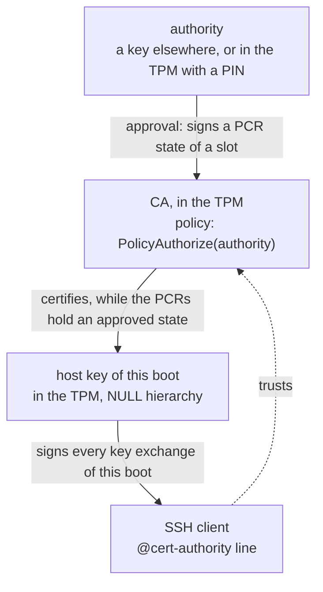
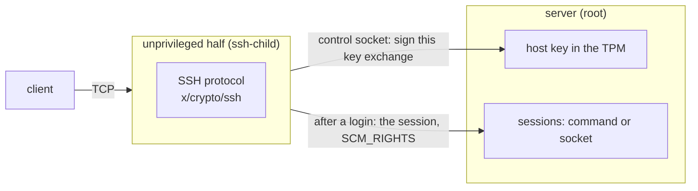

# aSSH: an SSH host key that never leaves the TPM

aSSH gives an SSH server a host key that is made inside the TPM, one per
boot, and certified by a certificate authority (CA) that is inside the TPM
too. The CA signs only while the machine is in a boot state its authority
approved. No host key and no secret of one is ever stored - not on the
disk, not in a boot image. Clients trust the CA with one `known_hosts`
line, which stays the same through reboots, updates and new PCR states.

It is a Go library and a command, `assh`. Who uses it:

- [tpm2-kira](https://github.com/mrwiora/tpm2-kira), as a library (a git
  submodule): the SSH server of its boot image, the CA approved by its
  signing key, kept outside the disk with `persist`.
- [safearch](https://github.com/tpm2-trust/safearch), as the command in
  its image and initrd: `assh agent` for sshd, `ca` with the PIN, `tpm
  sha1`, `efivar` for its own variables.

| Package | What it is |
|---|---|
| `hostkey` | the CA in the TPM, its slots and the approvals of the PCR states it signs in, the per-boot host key and its certificate - or a temporary key when no slot certifies |
| `server` | an SSH server split in two: the half that speaks SSH runs as a uid no one else has, in namespaces of its own, confined by `sandbox`, and holds neither the key nor what a login leads to |
| `agent` | an ssh-agent socket that lends the host key to OpenSSH's sshd (`HostKeyAgent`) |
| `config` | assh.conf: every setting in one `KEY=VALUE` file |
| `tpmadmin` | what the TPM itself holds for an authority with a PIN: the PIN, the dictionary attack parameters, the lockout authorization |
| `persist` | NV indices and EFI variables, written and removed one way for every program built on aSSH |
| `sandbox` | what a process that parses outside input takes from itself, on every thread; a uid for it that no one else has |
| `cmd/assh` | the command (below) |

## Quick start: sshd with a host key in the TPM

The authority in the TPM, opened by a PIN: no key to keep anywhere else.
On the machine, as root:

```bash
go build -o /usr/bin/assh ./cmd/assh
install -m 644 systemd/assh-agent.service /etc/systemd/system/

# 1. The TPM's dictionary attack protection, and a lockout authorization (asked twice; keep it off the machine)
assh tpm da --new-lockout-auth --max-tries 3 --recovery 1800 --lockout-recovery 1800

# 2. The CA's settings: two slots, the CA in an EFI variable
mkdir -p /etc/assh
cat >/etc/assh/assh.conf <<'EOF'
ASSH_CA=efi:AsshCA
ASSH_AUTHORITY_TPM=yes
ASSH_CA_SLOT_0=0,2,7,11,15
ASSH_CA_SLOT_1=7,15
EOF

# 3. sshd takes its host key from the agent
echo 'Include /run/assh/sshd.conf' >/etc/ssh/sshd_config.d/assh.conf
systemctl enable assh-agent.service
reboot
```

After that boot the agent serves a temporary key (there is no CA yet),
has recorded the PCRs of both slots and closed the window. Create the CA
and approve the recorded state:

```bash
assh ca create                                   # asks for the new PIN twice; prints the known_hosts line
assh ca approve --values /run/assh/agent.pcrs.json   # every slot: shows what it approves, asks, then the PIN
reboot
```

A CA signs from the boot after its creation; from then on the host key
is certified. On every client:

```
@cert-authority host.example,192.0.2.10 ecdsa-sha2-nistp256 AAAA...   # the line ca create printed
```

`assh ca show` prints that line again, the slots, the approvals, and
whether the CA signs in the state the PCRs hold now. A firmware or kernel
update: [Over the machine's life](#over-the-machines-life).

## How it works

### The keys

| Key | What it is | Where it is | Does it leave the TPM? | What lets it sign |
|---|---|---|---|---|
| **CA** | the machine's identity to SSH clients: ECDSA P-256 or RSA-2048 | made in the TPM; the CA file holds the TPM's wrapped copy | never: `fixedTPM` and `fixedParent`, the wrapped copy loads in this TPM alone | a PCR state the authority approved in one of its slots; no password |
| **authority** | the key whose signatures approve PCR states | elsewhere (a file, a YubiKey, an HSM), or in the TPM (the key A, its wrapped copy in the CA file) | elsewhere: only its public key comes to the TPM. In the TPM: made there, never leaves | elsewhere: whatever guards that key. In the TPM: the PIN |
| **host key** | the key of one boot: certified by the CA, or temporary | made in the TPM under the NULL hierarchy; stored nowhere | never; it loads nowhere after the next reboot | an authorization value in the server process's memory alone |



A new host key at every boot asks the clients nothing. The certificate's
principal is `*` by default (any name; the pattern in `known_hosts`
chooses the hosts) - OpenSSH refuses a host certificate without a
principal. Tested with OpenSSH 10.6.

Nothing in the CA file is a secret: the wrapped copies load in this TPM
alone, the rest are public keys and signatures. The CA, the authority in
the TPM and the host keys are noDA: a dictionary attack lockout never
stops them.

### Slots and approvals

The CA's policy is fixed when it is made (`ca create`), and names no PCR:

```
CA policy = PolicyAuthorize(Name of the authority, policyRef)
```

The Name is a hash of the authority's public key as the TPM loads it. The
policyRef (`--ref`, `assh` by default, at most 32 bytes) binds the
approvals to this use: an authority with several CAs signs approvals that
do not cross over. Since no PCR is in the policy, the CA and the clients'
line stay the same through every change of the PCRs.

**Slots.** A CA has up to 16 slots, 0 to 15, each a PCR selection
(`ASSH_CA_SLOT_<N>`; `ca create --pcrs` is slot 0). A slot needs no key to
be added: it lets the CA sign nothing until the authority approves a state
in it. Which PCRs a slot reads is yours to choose - PCR 11 (a unified
kernel image) or 14 (what an OS measures) to bind the OS, or only the
firmware and the Secure Boot state. Put the narrow selections first:

```
slot 0   PCR 0,7,11,15   the firmware, Secure Boot, this OS's kernel image   -> certified
slot 1   PCR 0,7,15      the firmware and Secure Boot, whatever the OS        -> certified
none                                                                          -> temporary key
```

An OS that went wrong still gets a certificate through slot 1, and from
that session its new state is approved for slot 0.

**An approval** (`ca approve --slot N`) is the authority's signature over
one PCR state of one slot:

```
approved       = PolicyPCR(the slot's PCRs, H(their values))  [; PolicyNV(G == n)   with a counter]
ApprovalDigest = SHA-256(approved ‖ policyRef)
```

The approval - the slot, the PCR values, the generation n, the signature -
goes into the CA file. It is a public statement ("the CA may sign while
the PCRs hold these values"), not a secret. The digest is computed
without the TPM, so a key elsewhere can sign it on another machine.

**Issue.** When a server starts it takes the slots from 0 up, and the
first with an approval for the PCRs as they are now:

```mermaid
sequenceDiagram
  participant S as assh agent / serve
  participant T as TPM
  S->>T: load the CA and the authority (owner hierarchy)
  S->>T: VerifySignature(authority, ApprovalDigest, signature)
  T-->>S: ticket, only if the authority signed it
  S->>T: policy session: PolicyPCR(the slot's PCRs as they are now)
  S->>T: with a counter: PolicyNV(G == n as it is now)
  S->>T: PolicyAuthorize(approved, policyRef, ticket)
  S->>T: PolicyCommandCode(Sign) ; PolicyNV(W == v): the window open
  Note over T: the session's digest is the CA's policy<br/>only if the state is the approved one<br/>and the window is open
  S->>T: make the host key (NULL hierarchy)
  S->>T: Sign the host certificate with the CA, in that session
  S->>T: NV_ReadLock(W): the CA signs nothing more this boot
```

An approval edited in the file fails the signature check; one for
another state fails PolicyPCR; one of an older generation fails PolicyNV.
Both keys are loaded in the owner hierarchy: PolicyAuthorize refuses the
ticket of a NULL-hierarchy key. When no slot holds, the host key is
temporary.

The CA's whole policy, fixed at creation:

```
CA policy = PolicyAuthorize(authority, ref) ; PolicyCommandCode(Sign) ; PolicyNV(W == v)
```

The part after PolicyAuthorize is the CA's own: no approval can leave it
out. In an approved state the CA signs and does nothing else (no Certify,
no Quote), and only while its window is open. Its ADMIN role goes through
the policy too (`adminWithPolicy`), so no empty password reaches it.

### The window

Every CA has a window index W of its own (`0x01802915` by default,
`ASSH_WINDOW_HANDLE`, `ca create --window-handle`): an NV counter that can
be read-locked until the next boot (`TPMA_NV_READ_STCLEAR`), given its one
value v when the CA is made. The CA's policy reads it, so closing the
window - `TPM2_NV_ReadLock(W)` - stops the CA in every slot, whatever an
approval says, until `TPM2_Startup(CLEAR)`: the next boot. A resume from
suspend keeps the lock.

- `agent` and `serve` close it right after the host key is certified - and
  on every other way out, a failure at any step included. The unit runs
  `assh close` after the agent too (`ExecStopPost=`), which also closes it
  when the agent could not start, or assh.conf does not parse.
- **A CA is created with its window closed**: it signs from the next boot
  on, never in a boot whose window has been open to every process. The
  one exception is a CA whose authority is made once (below): `ca create
  --window-open` (`ASSH_WINDOW_OPEN=yes`) leaves the window of its boot
  open, so that it signs in that boot until `agent` or `serve` closes it -
  for a creation where nothing untrusted runs before them (an initrd). Any
  other CA refuses it: its approvals come later, in a running system, where
  an open window signs for whoever comes first.
- W defined again alike (root can, with the owner authorization) has W's
  Name back, but its first value lands above every value a counter had:
  never v. Deleting or incrementing W stops the CA - a denial of service,
  never a way in.
- W is the window alone: closing it extends no PCR. A PCR in a slot (the
  combination in PCR 15, say) is what the approval says, nothing more.

### The temporary key

When no slot certifies - none approved for the PCRs as they are, the
counter gone, a CA file the TPM cannot load (a cleared or another TPM), or
no CA yet - `serve` and `agent` serve a **temporary host key**: made in
the TPM under the NULL hierarchy like every host key, gone at the next
reboot, not certified. They log its fingerprint and, for each slot, what
differs:

```
assh: host key SHA256:… is TEMPORARY: slot 0: PCR 7 not as approved; slot 1: PCR 7 not as
      approved. ssh reports an unknown host key: compare its fingerprint with this one
```

A client that trusts only the CA refuses the key (`StrictHostKeyChecking
yes`: "Host key verification failed"; `ask`: it shows the fingerprint and
asks). Compare it with the one on the console or in the journal and take
it for this boot: `ssh -o StrictHostKeyChecking=ask`, or the key's line in
`known_hosts`. A certified key of a later boot is taken beside that line;
remove it once the state is approved.

- It is made in the TPM, not in software: root could copy a software key
  and use it after the reboot against a client that took it.
- **`StrictHostKeyChecking=accept-new` takes a temporary key without
  asking** - anyone's, on a network an attacker controls - and keeps it.
  Do not use it for such a host.
- A CA file that cannot be read, or a TPM that cannot be opened, is an
  error, not a temporary key.
- **Before the CA exists** - its file or EFI variable not there, and
  assh.conf naming the slots - the PCRs of those slots are recorded. The
  CA is then created and this boot's recorded state approved (the quick
  start); the next boot certifies. Not in the same boot: a new CA's window
  is closed, or any process could have it certify.

## The authority

Who may approve a state is decided once, at `ca create`. Whoever
approves reads what is approved: `ca approve` shows each slot's statement -
the CA, the authority, the bank, every PCR and its value, the key of
signed PCRs, the generation - and asks before it signs (`--yes` for
scripts). Neither the CA file nor assh.conf is trusted for it: root could
have edited a slot to read PCR 7 alone.

| | Key elsewhere (`--authority PUB`) | In the TPM, a PIN (`--authority-tpm`) | Once (`--authority-once`) |
|---|---|---|---|
| Approves | whoever holds the key, on any machine | whoever knows the PIN, at the device, in any boot state | at creation only, every slot; never again |
| Revocation | none: an old approval works whenever that state boots | a counter: `--next-generation` ends every older approval | nothing to revoke |
| Guessing | the key's own protection | the TPM's dictionary attack lockout | nothing to guess |
| Suits | an administrator of many machines, a build host, tpm2-kira's signing key | one machine with its owner at it (safearch) | an image that never changes its boot path, with signed PCRs for updates |

Any of them can be combined with [signed PCRs](#pcrs-a-build-signs).

### A key elsewhere

Any RSA (2048, 3072, 4096 bits) or ECDSA (P-256, P-384) key; its private
key never comes to the machine.

```bash
# 1. The authority, once, off the machine
openssl ecparam -name prime256v1 -genkey -noout -out authority.key
openssl ec -in authority.key -pubout -out authority.pub

# 2. On the machine: the CA (slots from assh.conf, or flags)
assh ca create --out /etc/assh/os-ca.json --authority authority.pub --pcrs 0,7,11,15
# -> /etc/assh/os-ca.json.pub, and the known_hosts line

# 3. The statement of a state of a slot: the TPM's now (no --values), or one a server recorded
assh ca approve --ca /etc/assh/os-ca.json --slot 0 --values /run/assh/agent.pcrs.json --digest d.bin
# -> d.bin.statement (and d.bin, the digest alone)

# 4. Off the machine: read what it says, and sign it
assh ca sign --authority-key authority.key --statement d.bin.statement --signature d.sig

# 5. On the machine: add the approval
assh ca approve --ca /etc/assh/os-ca.json --slot 0 --values /run/assh/agent.pcrs.json --signature d.sig
```

- `ca sign` computes the digest from the statement it shows, not from
  bytes it cannot read, and refuses a statement for another authority.
  Signing `d.bin` with anything else (`openssl pkeyutl -sign -pkeyopt
  digest:sha256`) works too, but signs blind.
- With `--values`, steps 3 and 5 need no TPM: they run wherever a copy of
  the CA file is, and the file with the new approval goes back to the
  machine. Step 5 checks the signature before it saves.
- With the key at hand, `--authority-key authority.key` does steps 3 to 5
  in one, after showing the statement.

**Its approvals are never revoked.** Removing an approval from the file
revokes nothing: a copy of the file from before still works should the
machine boot that state again. To end an old state for good, make a new
CA, or use the authority in the TPM.

### In the TPM: a PIN, and revocation

Three things in the TPM besides the window index, none of them secret
outside it:

```
P  PIN index   NV counter at 0x01802913, its authorization value = the PIN.
               Written once when it is made, holding that value k for good.
               Its policy allows one more thing: a PIN change (NV_ChangeAuth).
A  authority   ECDSA P-256 key, made in the TPM, its wrapped copy in the CA
               file. Usable through PolicySecret(P) ; PolicyNV(P == k) ; Sign:
               the PIN, and no PCR condition.
G  counter     NV counter at 0x01802912, incremented through P - the PIN.
               Every approval names its value: PolicyPCR ; PolicyNV(G == n).
W  window      as every CA's (above).
```

```bash
assh tpm da --new-lockout-auth --max-tries 3 --recovery 1800 --lockout-recovery 1800
assh ca create --out /etc/assh/os-ca.json --authority-tpm --pcrs 7,14,15   # the PIN twice
assh ca approve --ca /etc/assh/os-ca.json --slot 0,1      # this state, both slots; the PIN once
assh ca approve --ca /etc/assh/os-ca.json --slot 0,1 --values /run/assh/agent.pcrs.json --next-generation
assh ca pin --ca /etc/assh/os-ca.json                     # change the PIN
assh tpm da --ask-lockout-auth --reset                    # end a lockout
```

- **Use stays automatic.** While the PCRs hold a state approved for the
  counter's current value, `Issue` gets its certificate with no PIN. It
  reads G, which is noDA and needs no authorization.
- **`--next-generation`** increments G with the PIN, then A signs the new
  state for the new value: every approval of an older value, in every
  slot, stops working inside the TPM, and one put back into the file is
  refused too. Without it the new approval is added beside the others.
- **The PIN** is what a TPM takes as an authorization value: 6 to 32
  bytes, any values, the last not zero (the TPM drops trailing zeros). No
  hashing, no normalization. It is read from the terminal without echo, or
  from a file descriptor (`--pin-fd N`, every byte as it is: `printf
  '%s'`, not `echo`) - never from argv or the environment, never stored,
  never logged. Whatever proves it runs in a salted HMAC session,
  whatever carries it is encrypted.
- **Wrong PINs** are counted by the TPM's dictionary attack protection, P
  being the only object here that is not noDA: guessed through A or
  through G, it is one counter. With `--max-tries 3 --recovery 1800`
  three wrong PINs lock it out, then one try per 30 minutes. During a
  lockout the right PIN is refused too; `Issue` is not affected. The
  parameters and the failure count are the TPM's, shared with every
  object that is not noDA (a volume unlocked with a TPM PIN, say).
- **The lockout authorization must be set**, and kept off the machine:
  without one any process may reset the lockout and try PINs without end.
  `ca create --authority-tpm` refuses a TPM without one. It is also what
  clears the TPM.
- **A PIN change** (`ca pin`) changes P's authorization value in place:
  the old PIN opens nothing afterwards, from any copy of any file; the CA,
  its approvals and the clients' line stay as they are.

### Once

`ca create --authority-once` (`ASSH_AUTHORITY_ONCE=yes`) makes the
authority in the TPM under the NULL hierarchy, has it approve every slot -
for the values the TPM holds, a recorded state (`--values`), or PCRs
calculated from their events (`--events PCR:EVENT`) - and flushes it; the
NULL hierarchy's seed is new at the next boot anyway. Nobody can approve
another state after: no PIN to guess, no key to steal, nothing root can
do. What the approvals do not cover gets a temporary key until the CA is
made again; with signed PCRs, updates need nothing. With `--window-open`
(`ASSH_WINDOW_OPEN=yes`) it certifies in the boot that made it as well
(see [The window](#the-window)).

### PCRs a build signs

A slot can take some of its PCRs from a key elsewhere instead of from an
approval: the signature of systemd's build for PCR 11 of a unified kernel
image, one per boot phase (`systemd-measure sign`; the UKI's `.pcrsig`, on
the running system `/run/systemd/tpm2-pcr-signature.json`). The slot's
approval holds the other PCRs and the key; the key vouches for PCR 11:

```
PolicyPCR(11) ; PolicyAuthorize(the build's key)        the TPM checks the build's signature
; PolicyPCR(the slot's PCRs) ; PolicyNV(counter)         the approval, as any other
```

A new build carries its own signature, so the slot stays met after an
update and nobody approves anything. Settings:
`ASSH_CA_SLOT_<N>_SIGNED=11`, `ASSH_PCR_KEY` (`ca create --pcr-key`: the
key, PEM; RSA with 2048 bits, which every TPM checks), `ASSH_PCR_SIGNATURE`
(where `agent` and `serve` read the signatures). `ca approve` refuses a
slot whose key is not `ASSH_PCR_KEY`: the CA file could name any. Every image the key
signed meets the slot, an old one too.

## Over the machine's life

### When the PCRs change

A firmware update, a new Secure Boot key or another boot path changes the
PCRs. A broader slot may still certify; when none does, the server serves
a temporary key until the authority approves the new state. The CA and
the clients' trust in it stay as they are.

1. **Boot the new state.** `agent` and `serve` record the values of every
   PCR a slot reads before they close the window, also when the CA does
   not sign (`--state`; `/run/assh/agent.pcrs.json`,
   `/run/assh/serve.pcrs.json`). The file holds the boot's first start: a
   restart keeps it (it would find the window closed).
2. **The authority approves that file** for the slots that should hold it
   (`ca approve --values FILE --slot N`).
3. **Reboot.** The window was closed at this boot; the approval takes
   effect at the next.

The values may come from elsewhere: a program that knows the next boot's
PCRs - tpm2-kira replays the firmware's event log and predicts PCR 11 -
approves them with the library (`CA.Approve`, `CA.AddApproval`) before the
reboot. `ca approve --events PCR:EVENT` calculates a PCR from zero with
the events given (a move ahead: PCR 15 as another combination's boot
leaves it). Approve only a state you trust: in it, the CA signs.

### The slots follow assh.conf

`ca create` makes every slot the file names; after an edit every command
takes the file's slots as they are - `agent` and `serve` at their next
start, nothing to run. A slot added signs nothing until approved; one
taken away, or whose PCRs changed, loses its approvals. The CA file keeps
what it has until a command saves the CA (`ca approve`), so an edit undone
brings the approvals back. The window index, the key type, the bank and
the ref are the CA's for good: a file that differs in them is not applied (the
CA's own slots, and a warning).

### When the TPM is cleared, the CA is lost

TPM2_Clear (`tpm2_clear`, "Clear TPM" in the firmware's setup, a firmware
update that resets a firmware TPM) gives the owner hierarchy a new storage
seed, and another TPM (a new mainboard) has one of its own. The wrapped
copies of the CA and of A then load nowhere, and P, G and W are gone
with the clear. Nothing brings the CA back, by design: a CA that could be
restored would be a secret kept outside the TPM.

What remains is what a new machine needs: `ca create`, an approval, and
the new `known_hosts` line on every client. Until then the temporary key
lets you log in - after checking its fingerprint - to do it.

### Removing a CA

`ca remove --ca FILE` removes the CA file, its window index and, for the
authority in the TPM, its PIN index and counter. An index goes only where
the TPM holds one defined exactly as aSSH defines it at that handle -
attributes, size, policy; the counter's policy names the PIN index the TPM
holds and its value, read there. What the file says is no proof: a file
edited to name another program's index leaves that index. With no file,
the handles of assh.conf or the flags are taken by the same rule. No PIN:
the owner authorization is enough. Clients then need a new line for the
next CA.

What is left is named, and `--force` removes it - for what a previous
installation left at aSSH's handles (an index of another format, a CA file
lost): every index at the handles of assh.conf or the flags, never one a
CA file names, each shown (handle, size, attributes, Name) and removed
after a confirmation (`--yes` for scripts).

## Where the CA is kept: a file or an EFI variable

Wherever a CA file goes (`--ca`, `--out`, `ASSH_CA`, `hostkey.LoadCA`,
`CA.Save`), `efi:NAME` names an EFI variable instead: efivarfs's
`/sys/firmware/efi/efivars/NAME-24415b90-39be-45c0-a9a3-d547ebe28ea0`,
non-volatile, boot service and runtime access, written in one piece
(compact JSON, about 1.2 KB with two slots and an approval in each). `ca
create --out efi:NAME` writes no `.pub`: the known_hosts line it prints is
the public key.

It is for a machine with no other place that survives a reboot (a
read-only image), and for an approval of a slot that measures the boot
image: inside that image it would change the measurement it approves.
Nothing in the variable is secret, so it is a plain variable, no
authenticated write. Whoever can write it (root, the firmware) can delete
the CA, never make it sign: a forged or edited approval is refused, a copy
loads in no other TPM. An older approval written back works only if the
machine boots that older state, and a counter revokes it.

The variable is the CA's only copy: firmware that wipes its variables
(some firmware updates, a reset of the NVRAM) loses the CA as a cleared
TPM does.

## The SHA-1 bank

A CA reads one PCR bank: `sha256`, `sha1`, or `auto` (`--bank`,
`ASSH_CA_BANK`). `auto` takes SHA-256 where the TPM has that bank active,
and SHA-1 only on a TPM whose firmware activates nothing else (an old
ThinkPad's) and only while the TPM allows it:

```bash
assh tpm sha1            # the active banks, whether sha1 is allowed, what auto is
assh tpm sha1 --allow    # NV index 0x01802914, defined by the owner
assh tpm sha1 --forbid
```

With `auto` on such a TPM, without the index, `agent` and `serve` serve a
temporary key and record nothing, `ca create` refuses, and a CA that reads
SHA-1 certifies nothing after `--forbid`. The index holds nothing and is
not signed: where SHA-256 is active it changes nothing, and which banks
are active only the firmware decides (TPM2_PCR_Allocate needs the platform
hierarchy). SHA-1 is the weaker hash: a collision helps an attacker who
chose both inputs, and the values a slot reads come from firmware, signed
images and Secure Boot variables, not from them.

## Serving

At its start a server has the TPM make a new host key and the CA certify
it (`hostkey.Issue`), then closes the window. The host key's authorization
value is in that process's memory alone (the process is not dumpable); the
key signs every key exchange of this boot, whatever the PCRs hold later.

### sshd's host key: `assh agent`

sshd keeps doing SSH; the agent signs for it.

```bash
assh agent --config /etc/assh/assh.conf   # what systemd/assh-agent.service runs
```

```
# /etc/ssh/sshd_config.d/assh.conf
Include /run/assh/sshd.conf
```

`systemd/assh-agent.service` starts it early (`Before=sysinit.target
sshd.service ssh.service`, `Type=notify`), ahead of anything else that
could ask the CA, and never restarts it: a restart within a boot would
find the window closed. sshd can be restarted. It writes into its
directory (`--dir`, `ASSH_AGENT_DIR`, `/run/assh`):

| File | What it is |
|---|---|
| `agent.sock` | the ssh-agent socket; it answers `--uid` (root: sshd) alone, and signs, nothing else |
| `host.pub` | the host key's public key (`HostKey`) |
| `host-cert.pub` | the CA's certificate for it (`HostCertificate`); not there for a temporary key |
| `sshd.conf` | `HostKey`, `HostCertificate` (when certified), `HostKeyAgent`, `HostKeyAlgorithms` |
| `status` | for anyone to read (a login message, a prompt): `key=`, `certified=yes\|no`, then `slot=`, `key_id=`, `ca=` or `why=` |
| `agent.pcrs.json` | the PCRs every slot reads, as the boot's first start found them (`--state`) |

`HostKeyAlgorithms` is what the TPM signs in, the certificate's first. For
an RSA key that is rsa-sha2-256, and rsa-sha2-512 only where the TPM has
SHA-512 (never SHA-1's ssh-rsa): sshd asks the agent for the algorithm a
client picks, and a signature the TPM cannot make drops the connection.

A certificate's key ID names the slot it was certified through and that
slot's PCRs (`assh slot=1 pcrs=7,15`, `assh slot=0 pcrs=0,2,7,15
signed=11`): a person sees in `ssh -v` ("Server host certificate")
whether the boot was approved exactly or through a looser slot. It is
information, signed with the rest; whoever must rely on the state checks
it themselves (a quote, an unlock that the TPM binds).

### A server of its own: `assh serve`

```bash
assh serve --ca ca.json --authorized-keys keys --listen :2222 \
    -- /usr/local/bin/unlock-menu          # run for each login, in a pseudo-terminal
assh serve --ca ca.json --authorized-keys keys --socket /run/myapp/session.sock
```

Only an interactive session is served: commands, subsystems and
forwardings are refused, and lines of `authorized_keys` with options in
front of the key are left out (the options are not honoured).

- **With a command** (after `--`) each login runs it, as `--user` or as
  assh runs, in a pseudo-terminal when the client asked for one (its size
  follows the client's window), with `ASSH_USER`, `ASSH_KEY` (the login
  key's fingerprint) and `ASSH_REMOTE` in its environment.
- **With `--socket`** each login is handed to the program listening there:
  a line of JSON first (`{"user", "key", "remote", "term", "cols",
  "rows"}`), then the session's bytes both ways.

The server is two processes of one program:



The half that speaks SSH is started by the server with the listening
socket and one end of a control socket. It runs as a uid no one else has
(below), in network, IPC, PID, mount and UTS namespaces of its own, and
before it reads a byte from the network takes from itself, on every thread
(`sandbox`): new privileges, being traced or read by another process of
its uid (not dumpable), memory that becomes executable, every file
(Landlock), the system calls that administer the machine and those that
make a namespace (seccomp: `clone` with a `CLONE_NEW*` flag, `clone3`). It
holds no host key - every signature is asked over the control socket - and
runs nothing: a login's shell becomes one end of a socket pair that it
relays. A compromise of the SSH code gets what a login gets, and no key.
At most 8 connections that have not logged in, 30 seconds each, and 8
sessions at once.

## assh.conf: every setting in one file

Every flag that says how a CA, a host key or a server is set up has a key
in `assh.conf` (package `config`): `KEY=VALUE` lines, `#` comments, values
quoted when they hold spaces, each key once. Every command takes `--config
FILE` and reads `/etc/assh/assh.conf` when it is there and none is named;
a flag given on the command line wins over the file.

```
# /etc/assh/assh.conf
ASSH_CA=efi:AsshOSCA
ASSH_CA_SLOT_0=0,2,7,11,15
ASSH_CA_SLOT_1=7,15
ASSH_AUTHORITY=/etc/assh/authority.pub
ASSH_PRINCIPALS=host.example,192.0.2.10
```

| Key | Flag | Default |
|---|---|---|
| `ASSH_TPM` | `--tpm` | `/dev/tpmrm0` |
| `ASSH_CA` | `--ca`, `ca create --out` | - (a file, or `efi:NAME`) |
| `ASSH_CA_TYPE`, `ASSH_CA_BANK` | `ca create --type` (`p256`, `rsa2048`, or a list in order of preference, `rsa2048,p256`: the first the TPM takes), `--bank` (`sha256`, `sha1`, `auto`) | `p256`, `sha256` |
| `ASSH_CA_SLOT_<N>` | `ca create --pcrs` (slot 0) | slot 0 `0,7` |
| `ASSH_CA_REF` | `ca create --ref` | `assh` |
| `ASSH_AUTHORITY`, `ASSH_AUTHORITY_TPM`, `ASSH_AUTHORITY_ONCE` | `ca create --authority`, `--authority-tpm`, `--authority-once` (`yes`/`no`) | - |
| `ASSH_WINDOW_OPEN` | `ca create --window-open` (`yes`/`no`; with `--authority-once` alone): the window of the creating boot left open | `no` |
| `ASSH_CA_SLOT_<N>_SIGNED`, `ASSH_PCR_KEY`, `ASSH_PCR_SIGNATURE` | PCRs of slot N a key signs, `ca create --pcr-key` (PEM), its signatures (systemd's JSON) | - |
| `ASSH_WINDOW_HANDLE`, `ASSH_PIN_HANDLE`, `ASSH_COUNTER_HANDLE` | `--window-handle`, `--pin-handle`, `--counter-handle` | `0x01802915`, `0x01802913`, `0x01802912` |
| `ASSH_HOSTKEY_TYPE`, `ASSH_PRINCIPALS`, `ASSH_KEY_ID` | `--key-type` (as `ASSH_CA_TYPE`, a list too), `--principals`, `--key-id` | `p256`, `*`, `assh` |
| `ASSH_STATE` | `--state` | the command's own |
| `ASSH_LISTEN`, `ASSH_AUTHORIZED_KEYS`, `ASSH_USER`, `ASSH_SOCKET` | `serve --listen`, `--authorized-keys`, `--user`, `--socket` | `:22` |
| `ASSH_CHILD_UIDS` | `serve --child-uids` | `0x7FFE0000-0x7FFEFFFF` |
| `ASSH_AGENT_DIR`, `ASSH_AGENT_UID` | `agent --dir`, `--uid` | `/run/assh`, `0` |

Nothing in it is secret, and nothing in it is trusted: it says what the
CA should look like, and the TPM checks the CA and its approvals. No PIN
goes into it. Other programs read and write the same file through
`config.Load`, `config.Write` (keeps comments and unknown lines) and
`Config.Match` (what every command applies); tpm2-kira keeps its SSH
server's settings in one.

## Commands

`assh help` gives every flag. Every command takes `--config FILE` and
`--tpm PATH`.

| Command | What it does |
|---|---|
| `ca create` | makes the CA in the TPM with its slots, its window index (closed in this boot; `--window-open` with `--authority-once`), and its authority: `--authority PUB`, `--authority-tpm` (asks for the new PIN), `--authority-once`; prints the known_hosts line |
| `ca show` | the CA, its slots and approvals, the known_hosts line; with the TPM: the counter's generation, whether the window is open and the CA signs now, the dictionary attack state |
| `ca approve` | approves a state for slots (`--slot N[,N...]`, default every slot): the TPM's now, `--values FILE`, `--events PCR:EVENT`; with the PIN (`--next-generation`, `--redefine-counter`), or a key elsewhere (`--authority-key`, `--digest`, `--signature`); shows the statement and asks (`--yes`) |
| `ca sign` | where the key is: signs what a statement says (`--authority-key`, `--statement`, `--signature`) |
| `ca pin` | changes the PIN (`--pin-fd`, `--new-pin-fd`) |
| `ca remove` | the CA and its window index, PIN index and counter; `--force` for leftovers at aSSH's handles |
| `tpm da` | the TPM's dictionary attack parameters, `--reset`, the lockout authorization (`--new-lockout-auth`, `--ask-lockout-auth`, `--lockout-auth-fd`) |
| `tpm sha1` | the active banks; `--allow`, `--forbid` |
| `efivar get NAME`, `set NAME VALUE` / `set --file FILE NAME`, `rm NAME` | an EFI variable, aSSH's (`NAME`) or another vendor's (`NAME-GUID`), the way `persist` does it |
| `serve` | an SSH server of its own (above) |
| `agent` | an ssh-agent for sshd (above) |
| `close` | closes the window, nothing else: the unit's `ExecStopPost=` |

`ASSH_EFIVARS` in the environment points every command at another
directory than efivarfs (tests).

## The library

`hostkey` works without `server`, `server` takes any `ssh.Signer`, and
`agent` lends any signer.

```go
ca, _ := hostkey.LoadCA("efi:AsshCA")          // or a file
tpm, _ := transport.OpenTPM("/dev/tpmrm0")
hk, err := hostkey.Issue(tpm, ca, hostkey.IssueOptions{
	Open: func() (transport.TPMCloser, error) { return transport.OpenTPM("/dev/tpmrm0") },
})
if hk.Temporary != nil {                    // no slot certified
	log.Printf("temporary host key %s: %v", hk.Fingerprint(), hk.Temporary)
}
ca.Close(tpm)                               // the window: no certificate after this, until the next boot

ln, _ := net.Listen("tcp", ":2222")
srv, err := server.Start(server.Options{
	Listener:       ln.(*net.TCPListener),
	HostKey:        hk.SSH(),               // the certificate and the key in the TPM
	AuthorizedKeys: keys,                   // server.ParseAuthorizedKeys
	Command:        func() *exec.Cmd { return exec.Command("/proc/self/exe", "ssh-child") },
	Session:        func(s *server.Session) { go handle(s) },   // or server.RunCommand
})
// and in main(): if os.Args[1] == "ssh-child" { server.ChildMain() }
```

A CA with an authority elsewhere, two slots, slot 0 with PCR 11 signed by
the build's key:

```go
signed, _ := hostkey.NewSigned([]int{11}, buildKey)
ca, _ := hostkey.CreateCA(tpm, authorityPub, hostkey.CAOptions{Type: hostkey.P256, Bank: hostkey.SHA256,
	Slots: []hostkey.SlotSpec{{Number: 0, PCRs: []int{0, 7, 11, 15}, Signed: signed}, {Number: 1, PCRs: []int{7, 15}}},
	PolicyRef: []byte("myapp")})                // its window closed: it signs from the next boot on
d, _ := ca.ApprovalDigest(0, values)        // sign d elsewhere, then:
ca.AddApproval(0, values, sig)              // or ca.Approve(signer, 0, values) with the key at hand
ca.Save("efi:AsshCA")
```

With the authority in the TPM (the PIN is a callback, asked when the TPM
needs it), or once:

```go
ca, _ := hostkey.CreatePINCA(tpm, hostkey.PINCAOptions{CAOptions: opts, PIN: askPIN})
ca.NextGeneration(tpm, askPIN)              // older approvals stop working
a, _ := ca.TPMAuthority(tpm, askPIN)        // a crypto.Signer
ca.Approve(a, 0, values)
tpmadmin.ChangePIN(tpm, ca, askOldPIN, askNewPIN)

ca, _ = hostkey.CreateOnceCA(tpm, opts, values) // every slot approved, the authority gone
hostkey.RemoveCA(tpm, "efi:AsshCA", hostkey.Handles{}) // the CA and its indices, where they are aSSH's
```

`tpmadmin` needs the go-tpm fork (below); a program that uses `hostkey`
without it builds with go-tpm as released.

### persist: what is kept outside a file

NV indices and EFI variables are written and removed one way, by aSSH and
by every program built on it (tpm2-kira; safearch's scripts through `assh
efivar`):

- **Only what is provably one's own is removed.** `persist.RemoveNV(tpm,
  handle, ours)` takes an index only when `ours` says so:
  `persist.Defined(public area)` - the attributes, size and policy its
  owner defines, for an index whose template is its owner's alone;
  `persist.Shaped` without the policy; `persist.Named(name)`, the Name of
  the very index. Anything else at the handle is left,
  `persist.ErrNotOurs`. `persist.Any` is for a removal a person asked for,
  having seen what is there (`ca remove --force`).
- **Absent is not an error.** A removal reports whether something went.
- **An EFI variable is written in place, in one write, never removed
  first** (`persist.WriteVar`): efivarfs replaces it whole, so a crash
  leaves the old value or the new one, never none. The immutable mark is
  lifted for a write and put back. `persist.ReadVar`, `persist.RemoveVar`;
  `efi:NAME` is aSSH's GUID, `efi:NAME-GUID` another vendor's.

### sandbox: confinement on every thread

`sandbox.Apply(sandbox.Policy{ReadBeneath: dirs})` confines the calling
process for the rest of its life: no new privileges, not dumpable (no
other process of its uid traces it or reads its memory), no memory that
becomes executable (`PR_SET_MDWE`), no file but beneath `dirs` (Landlock;
none with an empty policy), and none of the system calls that administer
the machine or make a namespace (seccomp). It returns what it did, for the log; a kernel
without Landlock or MDWE is said there, not an error.

prctl, Landlock and seccomp act on the thread that asks, and a Go program
runs on several from its start: each step is taken on every thread
(`syscall.AllThreadsSyscall`, seccomp's TSYNC). A program built with cgo
cannot do that and gets an error. It is the second line: the parent
starts the process without root, in namespaces of its own (as `server`
does); this is what the process then takes from itself.

`sandbox.ClaimUID(range, dir)` gives that parent a uid for the process
that no one else has: the first of the range (`sandbox.DefaultUIDs`,
`0x7FFE0000-0x7FFEFFFF`, above every range systemd hands out) that no
user or group database names and no process runs as, held by a lock file
in `dir` (`/run/assh/uid`) until `Release` - so two servers never share
one. `server` uses it, and falls back to nobody (65534) when none is free.
Sharing nobody would let every other nobody process signal the confined
one.

## Security

What it protects against, with any authority: a copy of the disk or the
boot image (no key in it), another machine (the CA loads in this TPM
alone), another PCR state (the CA does not sign), a process after the
window closed - or in the boot that created the CA, or after the agent
failed - (no certificate: the TPM enforces the window, not an approval), a
CA file or assh.conf edited by root (the TPM checks the CA; the owner reads
what is approved; `ca remove` removes nothing that is not aSSH's), a
compromise of the SSH code (no key in that process; no namespace it could
make, no process of its uid that could attach to it).

What it does not:

- **Root while the server runs** can read the host key's authorization
  value from its memory and have the TPM sign with it - until the next
  reboot, and on this machine only.
- **Whoever holds the authority** can approve another state: keep a key
  elsewhere on a token, or off the machine.

The authority in the TPM, against root on the device with the owner
authorization empty, as on most machines:

| Attack | Result |
|---|---|
| guessing the PIN, through A or G | the TPM's lockout, which root cannot reset without the lockout authorization |
| an approval of an older generation, in the file or put back into it | refused by PolicyNV in the TPM |
| undefining P and defining it again alike, with a PIN of one's own | the clone has P's Name but never its value k: the TPM sets a counter's first value above any value a counter of that Name had (TPM 2.0 Part 1, 37.2.6.3). It opens neither A nor G |
| undefining G and defining it again alike | until it is incremented its Name differs and the CA signs nothing; it cannot be incremented without the PIN; the owner's next `--next-generation` lands above every old value |
| replacing G with another index | the CA signs nothing; `ca approve --redefine-counter`, with the PIN, puts G back |
| copying the CA file to another TPM | neither the CA nor A loads there |
| undefining W and defining it again alike, to reopen the window | its first value lands above v: the CA signs nothing |

Not protected against:

- **Deleting** G stops the CA until `--redefine-counter`; **deleting P**
  ends approvals for good (no P can hold k again: the rule that stops the
  clone). `Issue` keeps working with the current approval; after the next
  change of the bound PCRs the CA must be created again, with a new
  known_hosts line. Both need only the owner authorization: a denial of
  service, never a way in.
- **Root that watches the PIN being typed** - reading the terminal or
  assh's memory - has it. Type it only in a system you trust.
- The key that salts the PIN's sessions is read from the TPM over the same
  bus; an active interposer on the bus could substitute it. It is not
  checked against the TPM's endorsement key.

## Building and testing

```bash
go build ./cmd/assh
go test -count=1 ./...
```

The TPM tests need `swtpm` (they are skipped without it); the command's
tests need OpenSSH's `ssh` and `ssh-keygen`, and `openssl`. They log in
with OpenSSH's client through a `@cert-authority` line, check that it
refuses a temporary key until the key is in `known_hosts`, approve a
recorded state with a signature openssl made, move a CA with a PIN to
another state, certify through a broader slot after the OS changed, and
run the agent across reboots of the software TPM. A CA in an EFI variable
is tested against a directory in place of efivarfs; on a machine efivarfs
itself is used (tpm2-kira's and safearch's VM runs).

## Known limits

- **go-tpm is pinned to an unreleased commit**
  (`v0.9.9-0.20261001171150-36f205946d7e`): v0.9.8 fails to sign with a
  host key whose random authorization value has a zero byte inside
  (google/go-tpm#446). Move to the first release with the fix.
- **assh builds with a fork of go-tpm** (`replace` in go.mod,
  github.com/mrwiora/go-tpm, the branch of google/go-tpm#452) for
  TPM2_NV_ChangeAuth and the response check of a command that changes an
  authorization value. Only `tpmadmin` needs it; a module that uses assh
  is not reached by the replace. Drop it once upstream has #452.
- **RSA-2048 host keys** sign rsa-sha2-256 in `serve` (many TPMs lack
  SHA-512); the agent's `sshd.conf` offers rsa-sha2-512 only where the TPM
  has it.
- **A cleared TPM, or wiped EFI variables, lose the CA**: there is no
  backup of it.
